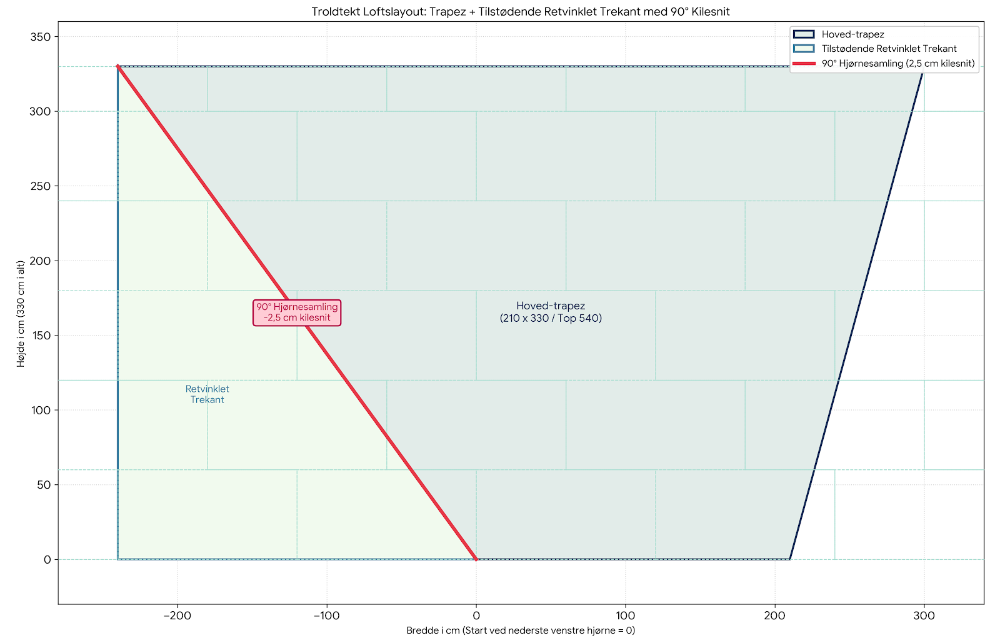

# KBJ Troldtekt Calc

# Troldtekt Loftslayout & Materialeberegning

Det samlede samlingstab udgør **5,0 cm pr. række** ved 90° knækket (2,5 cm skåret i smig på trapez-siden og 2,5 cm på trekant-siden).

---

## 1. Række-for-række Oversigt (med 5,0 cm smigtab)

| Række | Højde | Trapez bredde | Trekant bredde | Smigtab totalt | Samlet bredde pr. række |
| :--- | :--- | :--- | :--- | :--- | :--- |
| **Række 1** | 60 cm | 240,0 cm | 21,8 cm | + 5,0 cm | **266,8 cm** |
| **Række 2** | 60 cm | 300,0 cm | 65,5 cm | + 5,0 cm | **370,5 cm** |
| **Række 3** | 60 cm | 360,0 cm | 109,1 cm | + 5,0 cm | **474,1 cm** |
| **Række 4** | 60 cm | 420,0 cm | 152,7 cm | + 5,0 cm | **577,7 cm** |
| **Række 5** | 60 cm | 480,0 cm | 196,4 cm | + 5,0 cm | **681,4 cm** |
| **Række 6** | 30 cm *(tilskåret)* | 525,0 cm | 229,1 cm | + 5,0 cm | **759,1 cm** |

---

## 2. Materialeberegning for BEGGE Sider (× 2)

* **Pladeforbrug for én side:**
  * **Række 1–5 (60 cm højde):** Kræver ca. 21,5 hele plader.
  * **Række 6 (30 cm højde):** Én plade på 120 x 60 cm skæres igennem på langs og giver to stykker af 120 x 30 cm. Det forbruger ca. 3,2 plader.
  * **I alt pr. side:** Ca. 25,4 plader.

* **Samlet teoretisk forbrug for BEGGE spejlede sider:**
  $$25,4 \text{ plader} \times 2 = 50,8 \text{ plader}$$

* **Genbrug af afklip (Cutoffs) & Sikkerhedsmargen:**
  * De trekantede afklip skåret af fra Side 1 kan spejles og genbruges i modstående spidser og række-starter på Side 2.
  * Med en spildprocent på 8–10% (inkl. tilskæring af smig og tilpasningsstykker) lander det samlede behov på **55 til 56 plader**.

---

## 3. Endeligt Anbefalet Indkøb

* **Samlet antal plader:** **55–56 Troldtekt-plader** (120 x 60 cm).
* **Antal pakker:** Svarer til **11 til 12 pakker** (ved 5 plader pr. pakke).
* **Antal skruer:** 56 x 6 = **336 skruer.**